# Dev Team Orchestrator MCP

MCP server that runs a **spec-driven** LangGraph pipeline (dual runtime: **Cursor Task** playbook when models are `inherit`/`auto`/`cursor`, or **9router** ChatOpenAI otherwise):

1. System Architect → `README.md` + `.docs/requirements.md` (pré-reqs loop)
2. UI/UX Designer → score + `## UX / Juice addendum` in requirements (action/reaction; score ≥7)
3. Fidelity critic → hard FAIL vs `userIdea` (redo SA) — no silent stub pass
4. Technology Architect → `.docs/technologies.md`
5. UI/UX Designer → `.docs/ui-ux.md` (look-and-feel, palette, sensory, evidence-based emotion)
6. System Architect → `.docs/todo.md` plan (testable chunks from pré-reqs)
7. Per todo slug → SA detailed spec → UI/UX enrich (`## Flow & states` when UI) → TA technical enrich → `.docs/specs/{slug}.spec.md` (≥3 use cases)
8. Delivery critic (architecture) → idea ↔ tech/specs gaps
9. Scaffold → vite+vitest template / augment missing shell files
10. **QA TDD red** → failing tests from specs (use cases / screen-flow) **before** code
11. Software Engineer → TDD green; Clean Code + `===SELF_CHECK===`; `verifyDelivery` + `tsc`; redo with feedback — **does not** mark `[x]`
12. Delivery critic (delivery) → reopen incomplete slugs
13. **QA TDD verify** → run suite + gaps; mark `[x]` only when tests pass; optional `===TECH_DEBT===`
14. System Architect → project summary → `.docs/user-report.md`
15. Optional tech-debt plan → finalize → `.docs/pipeline-result.json`

**Workflows:** `full` | `docs` | `feature` (+ optional `slug`) | `punch` | `fix` | `resume` | `tests` (+ `slug`) | `analyze` (+ `scope` / `role`).

**MCP tools:** `run_development_pipeline`, `get_zteam_config`, `write_zteam_config`, `ensure_zteam_setup`, `get_pipeline_state`, `approve_gate` (HITL when `ZTEAM_HITL=1`).

Package docs and pipeline graph live under **`.docs/`** (not `docs/`) — same convention as app artefacts (`.docs/requirements.md`, …).

## Requirements phase (bootstrap + pré-reqs)

This slice only turns the user idea into durable requirements artefacts. It does **not** choose stacks or write code.

**Delivers**
- `README.md` — Resume (product/audience) and, during the loop, a temporary Pré Requirements checklist
- `.docs/requirements.md` — one `##` section per pré-req (goals, functional/NFR, normal+alt flows, acceptance; technology-agnostic)
- Clean README after the loop — Resume + links to docs (pré-req list removed)
- UI/UX juice pass — score 1–10, write `## UX / Juice addendum` (action/reaction feedback); score must improve to ≥7
- Fidelity gate — hard fail if requirements drift from `userIdea` (SA redo)

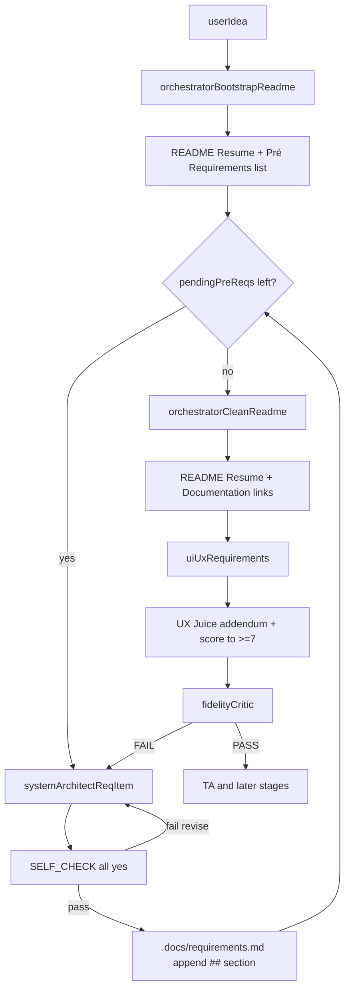

## Technology phase (`.docs/technologies.md` + 9-Layer Matrix)

Runs after fidelity PASS. The Technology Architect turns approved requirements into production-oriented tech decisions — **no feature code**.

**Delivers**
- `.docs/technologies.md` — 11 fixed H2 sections (`## Technology decisions`, `## Folder architecture`, `## Stacks`, `## Hosting / publish target`, `## Data persistence`, `## Scalability & growth`, `## Cost-benefit & services`, `## Specialized services`, `## Schemas / API exposure`, `## Security`, `## Development standards`)
- **9-Layer System Design + AI Stack Matrix** (inside `## Technology decisions` or `## Specialized services`) — every layer must be explicitly marked `adopt`, `defer`, or `none` so small projects never get bloated while complex ones never miss a layer
- README — Technology summary + link to `technologies.md`
- `===SELF_CHECK===` — nine yes/no gates (coverage ≥90%, folders, patterns, scale, cost, hosting, persistence, specialized services, owner can follow)

### The 9 System Design + AI Stack Layers

> **Harness vs Product:** Layer 7 (*AI, RAG & Agents*) refers strictly to **product** capabilities (if the app itself calls an LLM/RAG/MCP). The zteam orchestrator harness (LangGraph + MCP + Cursor/9router) is external and is never added to the product stack unless the product is an MCP/agent tool.

| # | Layer | Scope / Examples | Default when not required by `userIdea` |
|---|---|---|---|
| **1** | **Clients & Interfaces** | Web (React, Next.js), Mobile (Flutter, Swift, Kotlin, React Native), CLI, or headless | Guided by `projectType` (`needsUiFlow`) |
| **2** | **Edge, DNS & Traffic** | Cloudflare, Route 53, CloudFront, NGINX, Envoy, HAProxy | `none` (localhost / single host) |
| **3** | **APIs & Service Layer** | REST, GraphQL, gRPC · Direct app vs Gateway (Kong, Apigee, AWS API Gateway) | `none` (client-only) or direct REST (`crud`/`backend`) |
| **4** | **Messaging & Workflows** | Sync in-process vs Queues/Streams (SQS, RabbitMQ, Kafka, NATS, Pulsar) vs Orchestration (Temporal) | `none` (in-process sync) |
| **5** | **Data, Storage & Cache** | DB (PostgreSQL, MySQL, MongoDB, DynamoDB), Object Storage (S3), Cache (Redis) | `localStorage` / `none` (games) or single DB (`crud`/`backend`) |
| **6** | **Search, Vector & Retrieval** | Full-text (Postgres/OpenSearch/Elastic) vs Vector DB (pgvector, Pinecone, Milvus, Weaviate) | `none` (unless semantic search / RAG required) |
| **7** | **AI, RAG & Agents (product)** | Providers (OpenAI, Claude, Gemini), Orchestration (LangGraph, LlamaIndex), Product MCP/Tools | `none` (unless product uses AI) |
| **8** | **Eval, Compute & Deployment** | Compute (Local, Docker, Lambda, Cloud Run, K8s), CI/IaC (GitHub Actions, Terraform), LLM Evals | Local Vite/Node + Vitest (`adopt`) |
| **9** | **Security & Observability** | AuthN/AuthZ (OAuth 2.0, OIDC), Secrets (env, Vault), Telemetry (Console, OpenTelemetry, Prometheus/Grafana, Datadog) | `env` + structured console logs |

### Layer profiles by `projectType` (zero-bloat defaults)

| `projectType` | `adopt` by default | `none` by default (unless `userIdea` asks) |
|---|---|---|
| `webgame` / `frontend` | **1** (Clients), **8** (Vitest + static build) | **2, 3, 4, 6, 7** (`5` = in-memory/localStorage, `9` = minimal) |
| `crud` / `webapp` | **1** (UI), **3** (REST), **5** (DB), **8** (Test/Build), **9** (Auth/Validation) | **2** (Edge), **4** (Queues), **6** (Vector), **7** (AI) |
| `backend` | **3** (API), **5** (DB/Cache), **8** (Test/Runtime), **9** (Auth/Logs) | **1** (UI), **6, 7** |
| `fullstack` | **1, 2** (CDN/Edge), **3, 5, 8, 9** | **4, 6, 7** |

Only layers marked **`adopt`** are expanded in detail under the corresponding H2 sections (`## Data persistence`, `## Schemas / API exposure`, `## Security`, `## Hosting / publish target`) and turned into `.docs/specs/{slug}.spec.md` items.

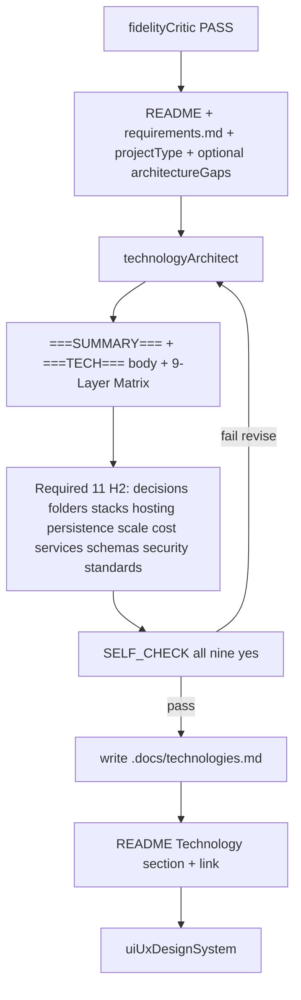

## UI/UX phase (juice + look-and-feel)

Two UI/UX stages: **juice** on requirements (before TA), then **look-and-feel** after technologies.md exists.

**Delivers**
- Juice: `## UX / Juice addendum` inside `.docs/requirements.md`; score before → after (≥7 and improved)
- Look-and-feel: `.docs/ui-ux.md` — style, hierarchy, palette, visual/sound/sensory behavior, evidence-based emotion strategies, evidence notes
- README link to ui-ux.md
- Design self-check: purposeful emotion, evidence-based techniques, no invented data

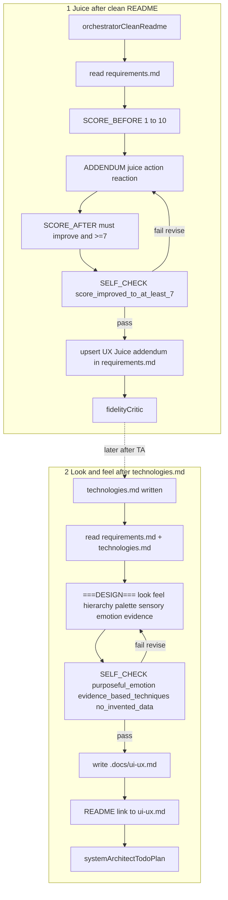

## Specs phase (todo.md + three-handed `.spec.md`)

After `.docs/ui-ux.md` exists, the System Architect plans a **short** `todo.md` only. Then each checklist item is written **three-handed**: SA → UI/UX → TA, iterating until every slug has a finalized `.docs/specs/{slug}.spec.md`.

**Delivers**
- `.docs/todo.md` — plan notes + `- [ ] slug: title` checklist (testable chunks from pré-reqs)
- Per slug `.docs/specs/{slug}.spec.md` — functionalities, all actions/reactions, **≥3 use-case examples (≥1 per scenario)**, acceptance, Files to touch, usability/juice, technical approach; UI/UX may add `## Flow & states` (screen-flow) when the slug is UI
- Self-checks at each hand (all must be yes before writing)

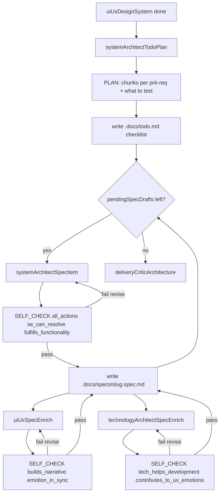

## Implementation (TDD) + owner report

Runs after scaffold (or punch/resume prepare). Docs-only and analyze skip this phase. Workflow `tests` runs QA-red → QA-verify only (no SE).

**Delivers**
- **QA TDD red** — failing vitest tests from each pending spec (use cases / screen-flow / `## Flow & states` when present); does **not** mark todos `[x]`
- **SE TDD green** — implement until code + `tsc` + `verifyDelivery` pass; Clean Code + `===SELF_CHECK===` (`covers_all_functionalities`, `covers_all_use_cases`, `follows_usability_and_emotions`); does **not** mark `[x]`
- **Delivery critic** — may reopen incomplete slugs back to SE
- **QA TDD verify** — run suite + gap tests; mark `[x]` only when tests pass; optional `.docs/tech-debt.md`
- `.docs/project-summary.md` + `.docs/user-report.md` — what the project does (for the owner)
- If tech debt exists: disposition + plan-mode `.docs/tech-debt-plan.md` (owner decides; not auto-implemented)

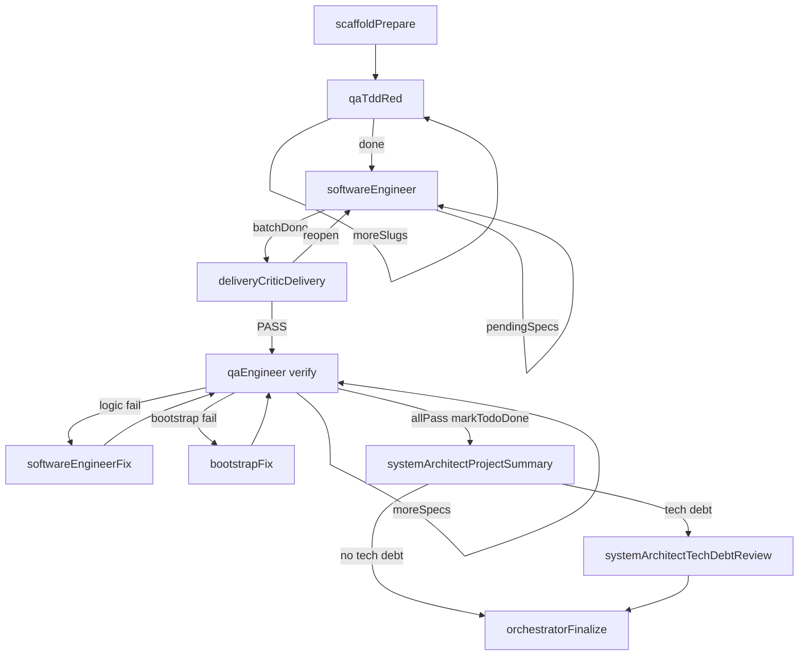

Matches LangGraph dump: [`.docs/langgraph.mmd`](.docs/langgraph.mmd) (`scaffoldPrepare → qaTddRed → softwareEngineer → … → qaEngineer`).

## Role skills injection

Role skills (`.zteam/skills/roles/`) are **focused** prompts per `(role × phase × projectType|qualifier)`. Runtime ([`src/skill-resolve.ts`](src/skill-resolve.ts)) injects an excerpt into every LLM stage via `invokeRoleLlm`, and into Cursor playbook `instructions` (`skillKey`). Catalog: [`.docs/todo-skills.md`](.docs/todo-skills.md). Index: [`.zteam/skills/roles/README.md`](.zteam/skills/roles/README.md).

Set `projectType` in `.zteam/config.json` (or env `ZTEAM_PROJECT_TYPE`) so the resolver can pick the right file. Values are lowercase ids, e.g. `crud`, `webgame`, `godotgame`, `webapp`, `backend`.

### How the runtime chooses which skill to inject

Decision order is fixed and auditable — no silent “best guess” beyond this chain:

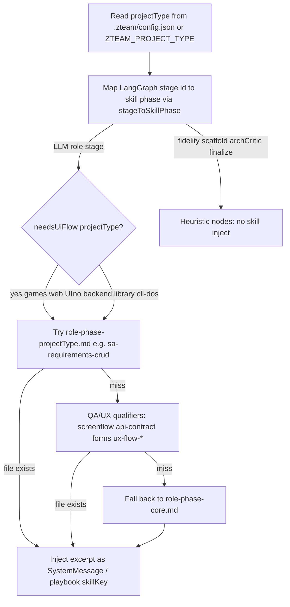

| `projectType` | `needsUiFlow` | Typical exact / qualifier hit (examples) | If exact missing |
|---------------|---------------|------------------------------------------|------------------|
| `crud` | true* (forms) | `sa-requirements-crud`, `ta-technologies-crud`, `qa-tdd-red-forms` → screenflow/forms path | `*-core` / `se-implement-tdd-green` |
| `webgame` | true | `sa-requirements-webgame`, `ux-juice-webgame`, `ux-flow-webgame`, `qa-tdd-red-screenflow`, `se-tdd-green-webgame` | same chain → core |
| `godotgame` | true | Prefer `*-godotgame.md` when on disk; QA uses **screenflow** (UI game) | core + screenflow qualifier until Godot pilots exist |
| `backend` | false | `sa-requirements-backend`, `ta-technologies-backend`, `qa-tdd-red-api-contract` | `*-core` |
| unset / unknown | true (prefer UI rigor) | try exact only if typed; else qualifier + core | always ends at `*-core` |

\* `crud` is in `PROJECT_TYPES_NEEDING_UI_FLOW` so forms/empty states stay strict; API-only backends should use `backend`.

### Overview — skills along the full pipeline

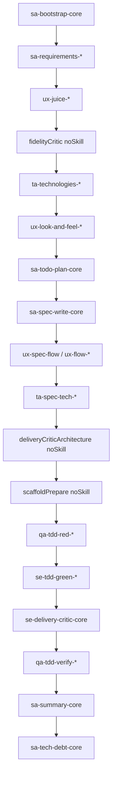

### 1 — System + technology + UX architecture

Bootstrap → requirements loop → juice → (fidelity) → technologies → look-and-feel.

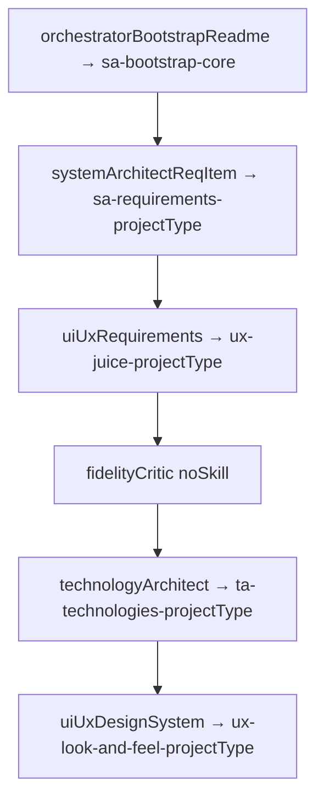

| Stage | Phase | Skill examples |
|-------|-------|----------------|
| Bootstrap README | `bootstrap` | `sa-bootstrap-core` |
| Expand pré-reqs | `requirements` | `sa-requirements-crud` / `webgame` / `godotgame`* / `backend` → else `sa-requirements-core` |
| UX juice | `juice` | `ux-juice-webgame` → `ux-juice-core` |
| TA stack | `technologies` | `ta-technologies-webgame` / `crud` / `backend` → core |
| Look-and-feel | `look-and-feel` | `ux-look-and-feel-webgame` → core |

\* `*-godotgame.md` when authored; until then resolve falls through to core while `needsUiFlow=true` keeps UX/QA on the screen-flow path.

### 2 — Todo plan + three-handed specs

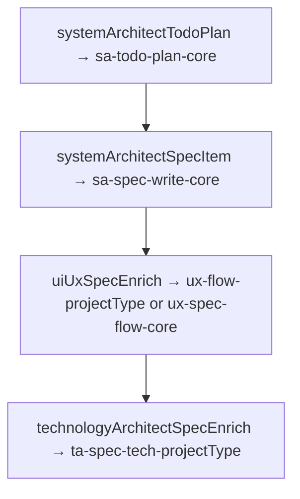

| Stage | Phase | Skill examples |
|-------|-------|----------------|
| Todo checklist | `todo-plan` | `sa-todo-plan-core` |
| Spec draft | `spec-write` | `sa-spec-write-core` |
| Flow & states | `spec-flow` | `ux-flow-webgame` / `ux-flow-webapp` → `ux-spec-flow-core` |
| Tech how-to | `spec-tech` | `ta-spec-tech-webgame` → `ta-spec-tech-core` |

### 3 — QA and tests

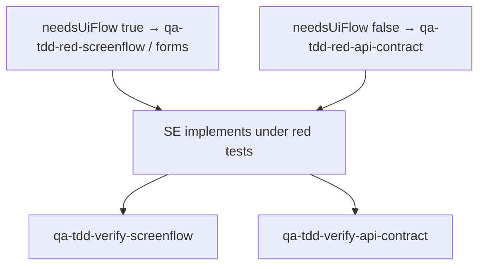

| Stage | Phase | Skill examples |
|-------|-------|----------------|
| TDD red | `tdd-red` | `webgame`/`godotgame`/`webapp`/`crud` → screenflow (+ forms for crud/webapp); `backend` → api-contract → `qa-tdd-red-core` |
| TDD verify | `tdd-verify` | same UI vs API split → `qa-tdd-verify-core` |

Workflow `tests` runs only this block (no SE). Docs-only stops before it.

### 4 — Development (TDD green + delivery spot-check)

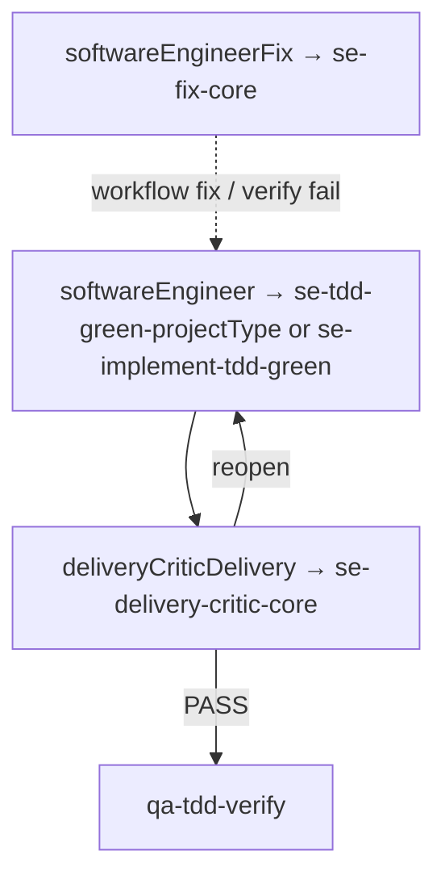

| Stage | Phase | Skill examples |
|-------|-------|----------------|
| Implement | `tdd-green` | `se-tdd-green-webgame` / `se-tdd-green-crud` → `se-implement-tdd-green` → `se-tdd-green-core` |
| Spot-check | `delivery-critic` | `se-delivery-critic-core` (playbook + when LLM critic is used) |
| Bug fix | `fix` | `se-fix-core` |

### 5 — Close-out + analyze shortcut

| Stage | Phase | Skill |
|-------|-------|-------|
| Owner report | `summary` | `sa-summary-core` |
| Tech-debt plan | `tech-debt` | `sa-tech-debt-core` |
| `workflow=analyze` | `analyze` | `sa|ta|ux|se-analyze-core`, `qa-analyze-coverage` |

**No skill inject:** `fidelityCritic`, `deliveryCriticArchitecture`, `scaffoldPrepare`, `bootstrapFix`, `orchestratorFinalize` (heuristic / non-role LLM).

## Setup

1. `cp .env.example .env` and fill in `NINEROUTER_BASE` / `NINEROUTER_KEY` (optional `MODEL_*`, `GRAPH_RECURSION_LIMIT`, `MAX_QA_FIX_ROUNDS`, `MAX_DELIVERY_FIX_ROUNDS`, `PROGRESS_HEARTBEAT_MS`).
2. `npm install`
3. Register the MCP server in Cursor (`~/.cursor/mcp.json`) under the key **`zteam`**:

```json
{
  "mcpServers": {
    "zteam": {
      "command": "npx",
      "args": ["tsx", "C:/path/to/dev-team-orchestrator/src/orchestrator.ts"],
      "env": {
        "NODE_NO_WARNINGS": "1",
        "NINEROUTER_BASE": "https://your-9router-host/v1",
        "NINEROUTER_KEY": "sk-your-key"
      }
    }
  }
}
```

**Do not** set a sticky `WORKSPACE_ROOT` in `mcp.json` — MCP tools **require** `workspaceRoot` = the Cursor-open folder on every call and **never** fall back to that env (avoids writing into a previous repo). Omitting it returns `failureKind=needs_workspace_root`. Credentials stay in env; workspace is per-call.

Cursor exposes the tool namespace as **`user-zteam`**. Restart MCP after changing the key.

### Team models — `.zteam/config.json`

Models resolve as: `{app}/.zteam/config.json` → `{workspace}/.zteam/config.json` → env `MODEL_*` → built-in defaults.

The config gate opens when a config file exists **or** explicit `MODEL_*` env vars are set (`configGateSatisfied`). Otherwise the pipeline returns `failureKind=needsConfig` (CLI: `--skip-config-gate` for smoke).

Example:

```json
{
  "version": 1,
  "projectType": "webgame",
  "models": {
    "systemArchitect": "9RSA-system-architect-free",
    "technologyArchitect": "9RTA-technology-architect-free",
    "uiUxDesigner": "9RSA-system-architect-free",
    "softwareEngineer": "9RSE-software-engineer-free",
    "qaEngineer": "9RQA-qa-free",
    "fallback": ""
  },
  "maxTokens": {
    "systemArchitect": 1600,
    "technologyArchitect": 2500,
    "uiUxDesigner": 2000,
    "softwareEngineer": 8000,
    "qaEngineer": 2000
  }
}
```

`projectType` drives role-skill resolution (`crud` | `webgame` | `godotgame` | `backend` | …) — see [Role skills injection](#role-skills-injection).

MCP tools: `get_zteam_config`, `write_zteam_config`, `ensure_zteam_setup`, `run_development_pipeline`, `get_pipeline_state`, `approve_gate`.

### Env vars (orchestrator)

| Var | Role |
|-----|------|
| `NINEROUTER_BASE` / `NINEROUTER_KEY` | 9router OpenAI-compat endpoint |
| `ZTEAM_FORCE_BOOTSTRAP=1` | Force wipe of `.docs/requirements.md` on full/docs bootstrap (default: preserve if file has real `##` sections) |
| `ZTEAM_SE_BATCH` | SE batch size 1–3 (default **1**; workflow `punch` defaults to 3) |
| `MODEL_FALLBACK` / `*Fallback` per role | Local handoff after primary exhausts retries |
| `MODEL_SYSTEM_ARCHITECT_FALLBACK` etc. | Env override for per-role fallback |
| `MAX_DELIVERY_FIX_ROUNDS` | SE verify redo rounds (default 3) |

**After changing orchestrator source:** restart the MCP server `user-zteam` (no hot-reload). Confirm discovery lists config tools.

## Cursor — `@zteam` / `/zteam`

| Trigger | What |
|---------|------|
| **`@zteam`** | Manual rule [`.cursor/rules/zteam.mdc`](.cursor/rules/zteam.mdc) in the mention picker |
| **`/zteam`** | Project skill [`.cursor/skills/zteam/SKILL.md`](.cursor/skills/zteam/SKILL.md) |
| Natural language (“roda o zteam…”) | Always-on rule [`.cursor/rules/dev-team-orchestrator.mdc`](.cursor/rules/dev-team-orchestrator.mdc) routes to the same MCP tool |

Always call `user-zteam.run_development_pipeline` (not Cursor Task subagents).

Examples:

```text
@zteam build a pac-man demo in samples/pacman
/zteam docs-only — plan a todo API in samples/todo-api
/zteam punch — make the submit button blue in samples/my-app
```

Always pass `workspaceRoot` (absolute Cursor open folder) and `projectRoot` when you can. Optional `workflow`: `full` | `docs` | `feature` | `punch` | `fix` | `resume` | `tests` | `analyze` (omit = auto-router). Optional `slug` (feature/tests), `role` + `scope` (analyze).

Skill subcommands: **`@zteam/config`**, **`@zteam/models`**, **`@zteam/documentation`**, **`@zteam/tests`** — see [`.zteam/README.MD`](.zteam/README.MD). When models are Cursor aliases (`inherit`/…), MCP returns `delegationPlaybook` — run stages via Cursor Task (incl. QA-red before SE).

Also see the always-on routing rule for stage/env details. Rescue mid-failure with `workflow=resume` (see skill). Resume reopens phantom `[x]` todos whose Files to touch are missing on disk.

## Modes / workflows

| Mode | How | Route |
|------|-----|--------|
| **auto** | omit `workflow` | `workflowRouter` classifies from idea + `.docs` on disk |
| **full** | `workflow=full` | … → arch critic → scaffold → **QA-red\*** → **SE\*** → delivery critic → **QA-verify\*** → SA summary → optional tech-debt plan → finalize |
| **docs** | `workflow=docs` or `docsOnly=true` / `--docs-only` | … → (SA→UX→TA spec)\* → arch critic → finalize (no SE/QA) |
| **feature** | `workflow=feature` (+ optional `slug`) | SA todo plan → (SA→UX→TA spec)\* → arch critic → scaffold → QA-red\* → SE\* → QA-verify\* → SA summary → optional tech-debt plan → finalize |
| **punch** | `workflow=punch` | prepare → QA-red → SE → QA-verify → SA summary → optional tech-debt plan → finalize |
| **fix** | `workflow=fix` | prepare → SE fix → QA-verify → SA summary → optional tech-debt plan → finalize |
| **resume** | `workflow=resume` | reopen phantoms + pending `[ ]` → scaffold → QA-red\* → SE\* → QA-verify\* → SA summary → optional tech-debt plan → finalize |
| **tests** | `workflow=tests` (+ `slug`) | QA-red\* → QA-verify\* → finalize |
| **analyze** | `workflow=analyze` (+ `scope` / optional `role`) | analyzePrepare → `.docs/reviews/…` → finalize |

Catalog + classifier: [`src/workflows/`](src/workflows/) (`WORKFLOW_CATALOG`). Graph dump: [`.docs/langgraph.mmd`](.docs/langgraph.mmd) · LangGraph Studio: [`.zteam/langgraph/README.md`](.zteam/langgraph/README.md) (`npm run studio` / `npm run graph`). Multiagent ideal (future): [`.docs/adr-multiagent-flow.md`](.docs/adr-multiagent-flow.md). Open product backlog: [`.docs/postmortems/8-zteam-pipeline-review-improvements.md`](.docs/postmortems/8-zteam-pipeline-review-improvements.md). Skills catalog + charter: [`.docs/todo-skills.md`](.docs/todo-skills.md).

### Workflow `full` (no completo — agrupado em 4 macro-fases)

Para facilitar o entendimento do fluxo ponta a ponta, os **17 passos** do `workflow=full` agrupam-se em **4 macro-fases**:

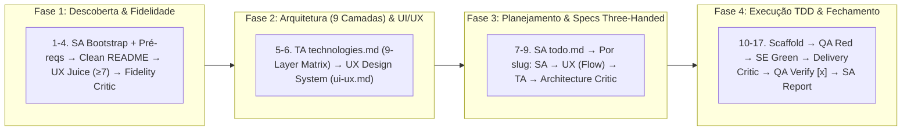

| Macro-Fase | Passos no Grafo | Papéis / Nós | Artefactos e Gates |
|---|---|---|---|
| **1. Descoberta & Fidelidade** | **1.** Bootstrap README + lista de pré-reqs<br>**2.** Loop SA (expande 1 pré-req por vez)<br>**3.** Clean README<br>**4.** UX Juice + Fidelity Critic | `SA` → `UX` → `fidelityCritic` | `README.md`, `.docs/requirements.md` (tech-agnostic + `## UX / Juice addendum` score ≥7). **Gate:** Hard FAIL se desviar da `userIdea` (`llm_empty` se vazio). |
| **2. Arquitetura (9 Camadas) & Design** | **5.** Decisões de stack + Matriz das 9 Camadas (`adopt \| defer \| none`)<br>**6.** Look-and-feel, paleta, emoção baseada em evidência | `TA` → `UX` | `.docs/technologies.md` (11 H2 + 9-Layer Matrix), `.docs/ui-ux.md`. **Gate:** 9 chaves `TA_SELF_CHECK` + 3 chaves `UX_DESIGN_SELF_CHECK`. |
| **3. Planejamento & Specs Three-Handed** | **7.** Plano de chunks testáveis<br>**8.** Escrita a 3 mãos por slug (SA → UX → TA)<br>**9.** Crítico de arquitetura (ideia ↔ 9 camadas ↔ specs) | `SA` → `UX` → `TA` → `archCritic` | `.docs/todo.md`, `.docs/specs/{slug}.spec.md` (≥3 use cases, `## Flow & states` se UI, `Files to touch` limpos). **Gate:** Reabre `TA` se faltar camada ativa ou spec. |
| **4. Execução TDD & Fechamento** | **10.** Scaffold + `npm install`<br>**11.** **QA TDD Red** (testes falhando antes do código)<br>**12.** **SE TDD Green** (código + `tsc` + `verifyDelivery`)<br>**13.** Delivery Critic<br>**14.** **QA TDD Verify** (suite verde → marca `[x]`)<br>**15–17.** Resumo SA, plano de tech-debt (opcional) e finalize | `scaffold` → `QA-red` → `SE` → `delCritic` → `QA-verify` → `SA` → `finalize` | `src/**`, `**/*.{test,spec}.*`, `.docs/user-report.md`, `.docs/tech-debt-plan.md` (se houver dívida), `.docs/pipeline-result.json`. **Gate:** SE nunca marca `[x]`; QA só marca `[x]` com testes verdes. |

---

### Workflows por partes (fatias isoladas)

Quando não quiser rodar o pipeline monolítico (`full`), use as capacidades isoladas agrupadas em **3 famílias**:

#### Família A — Setup & Diagnóstico (sem implementar código de produto)

| Parte / Comando | Como acionar | Fluxo interno (passos agrupados) | Escreve em |
|---|---|---|---|
| **Config / Models** (`@zteam/config`, `@zteam/models`) | Tools MCP `get_zteam_config` → `write_zteam_config` | Lê config atual → valida família homogénea (`cursor` vs `ninerouter`) e `projectType` → grava `.zteam/config.json` (+ `.gitignore`). | `.zteam/config.json`, `.gitignore` |
| **Bootstrap de estrutura** (`ensure_zteam_setup`) | Tool MCP `ensure_zteam_setup` | Materializa `.zteam/skills/SKILL.md`, `.zteam/langgraph/` (Studio launcher) e pasta `.docs/` inicial — **zero chamadas LLM**. | `.zteam/**`, `.docs/langgraph.mmd` |
| **Análise / Review** (`workflow=analyze`) | `workflow: "analyze"` + `scope` (+ `role` opcional) | `analyzePrepare`: roda **um papel específico** (`sa`, `ta`, `ux`, `se`, `qa`) ou o **time inteiro** em modo crítico read-only sobre uma spec/pasta/requisito. | `.docs/reviews/*.md` (não toca em `src/**` nem marca `[x]`) |

#### Família B — Só Documentação, Arquitetura & Specs (`workflow=docs` / `@zteam/documentation`)

Executa apenas as **Macro-Fases 1, 2 e 3** e para antes do código:

```text
Bootstrap → SA Requirements Loop → UX Juice → Fidelity Critic
  → TA technologies.md (9-Layer Matrix) → UX ui-ux.md
  → SA todo.md → (SA → UX → TA spec por slug)* → Architecture Critic → Finalize
```

- **Quando usar:** Validar requisitos, escolher as 9 camadas de arquitetura e fechar contratos `.spec.md` antes de gastar tokens de SE/QA.
- **Isolamento:** Zero escrita em `src/**` ou ficheiros de teste.

#### Família C — Execução & TDD por fatia (`feature`, `tests`, `punch`, `fix`, `resume`)

| Workflow | Gatilho / Parâmetros | Passos agrupados que executam | Diferença chave |
|---|---|---|---|
| **Uma Feature** (`workflow=feature`) | `workflow: "feature"`, `slug` (opcional) | **Macro-Fase 3 + 4** (pula Requirements/TA global): `SA todoPlan` → `SA→UX→TA spec` → `archCritic` → `scaffold` → `QA-red` → `SE-green` → `QA-verify` → `SA summary`. | Usa `requirements.md` e `technologies.md` já existentes; foca nos novos slugs. |
| **Só Testes (TDD)** (`workflow=tests` / `@zteam/tests`) | `workflow: "tests"` + `slug` | `qaTddRed` (cria/reforça testes a partir da spec usando qualifier `screenflow` / `api-contract` / `forms` / `ai-rag`) → `qaEngineer` (verify) → `finalize`. | **Não roda SE**; escreve apenas em `**/*.{test,spec}.*`. |
| **Mudança Rápida** (`workflow=punch`) | `workflow: "punch"` | `punchPrepare` (reabre ou cria spec alvo) → `QA-red` → `SE-green` (batch curto) → `QA-verify` → `SA summary` → `finalize`. | Pula toda a fase de arquitetura; direto ao ciclo TDD do ajuste. |
| **Correção de Bug/Suite** (`workflow=fix`) | `workflow: "fix"` | `fixPrepare` → `softwareEngineerFix` → `QA-verify` (loop até passar ou `bootstrapFix` se erro de ambiente) → `SA summary` → `finalize`. | Pula `QA-red`; corrige implementação contra testes/erros existentes. |
| **Retomada Segura** (`workflow=resume`) | `workflow: "resume"` | `resumePrepare` (reabre `[x]` fantasmas cujos `Files to touch` faltam no disco + specs `[ ]` pendentes) → `scaffold` → `QA-red` → `SE-green` → `QA-verify` → `SA summary`. | Recupera execuções interrompidas sem refazer `.docs` já aprovados. |

---

LangGraph overview (simplified; full dump in [`.docs/langgraph.mmd`](.docs/langgraph.mmd)):

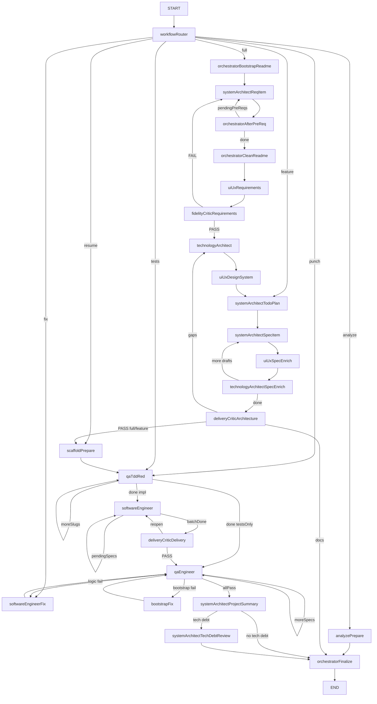

SE answers: `covers_all_functionalities`, `covers_all_use_cases`, `follows_usability_and_emotions`. QA (red + verify) answers: `tests_cover_all_use_cases`, `no_unresolved_spec_conflicts` (conflicts go to `.docs/tech-debt.md`). Todos `[x]` only after QA-verify PASS. After QA, SA presents a project summary; if tech debt exists, SA judges it against requirements/spirit and leaves a plan-mode action plan for you to decide.

Hard guard: refuses to write when `projectRoot` is `.` and `appRoot` equals the orchestrator package, or when a path escapes `workspaceRoot`. `GRAPH_RECURSION_LIMIT` default **120**.

## Resilience (empty / invalid LLM)

- Empty/whitespace replies, missing `===FILE===`, empty file bodies, and failed docs section parses are **retryable** (re-prompt + optional model fallback).
- After exhausted retries on docs/SE: **`failureKind=llm_empty`** — no silent TBD / implement-core stubs.
- Network / 429 / 5xx are also retried.
- Delivery verify FAIL → structured feedback + redo until `MAX_DELIVERY_FIX_ROUNDS`.

## Live progress & 9Router-style Canvas Dashboard (`.zteam/dashboard/index.html`)

Every bootstrapped project automatically gets **`.zteam/dashboard/index.html`** — a self-contained dark Canvas UI inspired by the **9Router overview** that works directly from disk (`file://`, zero web server required):

- **Animated Radial Canvas:** central `zTeam Orchestrator` hub firing glowing Bézier particles to/from `System Architect`, `UI/UX Designer`, `Tech Architect`, `QA TDD Red`, `Software Engineer`, `QA TDD Verify`, and `Critics & Gates` as each agent is called or consults a teammate.
- **Top KPI Cards:** *Total Events*, *Payload Chars In*, *Specs Progress*, *Output Chars*, and *Retries / Fixes*.
- **Recent Agent Activity Feed:** live stream of stages, active `skillKey`, chars `↑/↓` or files touched, and relative timestamps.
- **Zero-server JSONP polling:** the orchestrator writes `.docs/zteam-live.js` (`window.__ZTEAM_LIVE__ = ...`) and `.docs/zteam-live.json` on every LangGraph node, LLM call (`invokeRoleLlm`), teammate consult (`consultTeammate`), or `get_pipeline_state` push; the HTML page reloads `.docs/zteam-live.js` every 1 second.
- **Clean Chat Contract:** when running in Cursor (`delegationPlaybook`), the orchestrator agent pushes subagent start/done events via `get_pipeline_state({ recordStage, recordRole, recordStatus, recordMessage })` so the HTML dashboard animates the full work while the Cursor chat prints **only the 1-line `chatBanner`**.

While the pipeline runs (MCP tool or CLI):

- **stage** start/done with pending-spec hints
- **heartbeat** every ~30s of silence (`PROGRESS_HEARTBEAT_MS`, default `30000`) while waiting on LLM stream or `npm test`
- **partial** truncated preview after a heartbeat if stream text is interesting (`===FILE===` / section markers)
- MCP: `notifications/message` (logging) + `notifications/progress` when the client sends `progressToken`
- CLI: same lines on **stderr**; final `notifications[]` matches the live log
- Pre-pipeline **healthcheck** on 9router/tunnel for `full`/`docs`/`feature` (&lt;30s fail-fast)

## CLI

```bash
npm run pipeline:docs -- --workspace-root C:/path/to/open/folder --project-root samples/my-app "idea…"
npm run pipeline -- --workflow punch --workspace-root C:/path/to/open/folder --project-root samples/my-app "só muda a cor do botão"
npm run pipeline -- --project-root samples/my-app "idea…"   # workspace from env/cwd; prefer --workspace-root
npm run pipeline:feature -- --project-root samples/my-app "add CSV export"
npm run pipeline:resume -- --project-root samples/my-app "resume pending"
npm run graph
npm run studio          # LangGraph Studio (topology of the pipeline graph)
npm run smoke
npm run smoke:workflows
npm run smoke:reqs
npm run smoke:files
npm run smoke:improvements
npm run smoke:architecture
npm run smoke:implementation
npm run smoke:zteam-config
npm run smoke:role-prompts
npm run smoke:verify
npm run smoke:all
```

Use `--workspace-root` + `projectRoot` so generated docs land in the app folder, not this MCP package.

**LangGraph Studio:** `npm run studio` (or from a client project: `node .zteam/langgraph/dev.mjs`) opens the Agent Server; UI at `https://smith.langchain.com/studio/?baseUrl=http://127.0.0.1:2024`. Shows pipeline **topology** only — not live MCP run traces. Client bootstrap always materializes `.zteam/langgraph/` + copies `.docs/langgraph.mmd` when available.

### Smoke

- `npm run smoke` — retryable empty LLM + heartbeat
- `npm run smoke:workflows` — classifier heuristics
- `npm run smoke:reqs` — Resume / Pré Requirements parsers + safe appRoot guard
- `npm run smoke:files` — FILE sanitize, recursion helper, test preflight, fidelity heuristic
- `npm run smoke:improvements` — bootstrap/vitest/scaffold/FILE repair/progress close/healthcheck/metrics
- `npm run smoke:architecture` — architecture progress pack
- `npm run smoke:implementation` — implementation progress pack
- `npm run smoke:zteam-config` — workspaceRoot override, `.zteam` merge, needsConfig, gitignore
- `npm run smoke:role-prompts` — personas, SELF_CHECK parsers, SE/QA/SA summary + tech-debt plan
- `npm run smoke:verify` — DoD / anti-batch / phantoms / architecture gaps / metrics
- CI: [`.github/workflows/zteam-smokes.yml`](.github/workflows/zteam-smokes.yml) runs `smoke:all`

Optional live check (needs 9router): run `npm run pipeline:docs -- --project-root samples/smoke-app "tiny idea"` and confirm heartbeats if a stage exceeds 30s.
